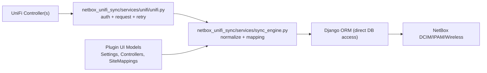
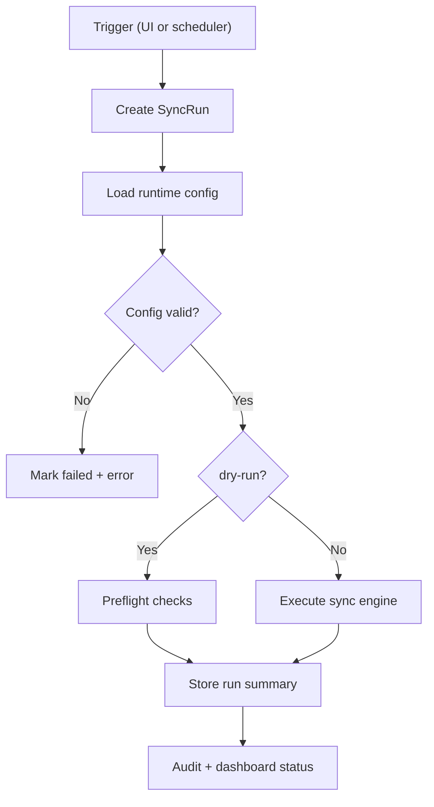

# Architecture

## Overview




## API Compatibility

### Integration API (v1)

- Uses `UNIFI_API_KEY`
- Base URL candidates are auto-probed:
  - `<base>/proxy/network/integration/v1`
  - `<base>/integration/v1`
  - or direct URL if already ending with `/integration/v1`
- Header formats are auto-probed (`X-API-KEY`, `Authorization`, or custom `UNIFI_API_KEY_HEADER`)
- `Sites` and resource pagination are handled with `offset`/`limit`
- `unifi.ui.com` cloud API keys are not treated as local Integration API keys

### Session login (UniFi OS / legacy)

- Uses `UNIFI_USERNAME` + `UNIFI_PASSWORD` (+ optional `UNIFI_MFA_SECRET`)
- Login endpoints are auto-tried:
  - `/api/auth/login` (UniFi OS)
  - `/api/login` (legacy)
- Clears cached cookies and CSRF state before a fresh login, then uses the new session cookie and optional CSRF token
- Session metadata is cached in `~/.unifi_session.json` with file mode `0600` (and auto-tightened if existing file permissions are too open)

## Request Behavior

- Retryable status codes: `408, 425, 429, 500, 502, 503, 504`
- Exponential backoff controlled by:
  - `UNIFI_HTTP_RETRIES`
  - `UNIFI_RETRY_BACKOFF_BASE`
  - `UNIFI_RETRY_BACKOFF_MAX`
- `Retry-After` is honored when present
- Request timeout: `UNIFI_REQUEST_TIMEOUT`

## Parallelism Model

```text
Controller pool (MAX_CONTROLLER_THREADS)
  -> Site pool (MAX_SITE_THREADS)
    -> Device pool (MAX_DEVICE_THREADS)
```

Default thread limits:
- controller: `5`
- site: `8`
- device: `8`

## Shared Caches / Locks

Main thread-safe structures in `netbox_unifi_sync/services/sync_engine.py`:
- `vrf_cache` + per-name locks
- `_custom_field_cache`
- `_tag_cache`
- `_vlan_cache`
- `_cleanup_serials_by_site`
- `_unifi_dhcp_ranges`
- `postable_fields_cache`
- a shared prefix creation lock across site and device workers

Runtime environment changes are serialized across sync invocations within the
same process. Controller groups with different site mappings execute separately;
stale cleanup is disabled when more than one group is needed, to avoid treating
another group's devices as stale. These locks do not coordinate separate worker
processes.

## Sync Flow (high-level)

1. Load runtime config from plugin models (`Settings`, `Controllers`, `Site mappings`)
2. Use the UI model state as runtime input; non-secret `PLUGINS_CONFIG` defaults are optional bootstrap input
3. Resolve NetBox tenant/roles/sites
4. Group controllers by credentials and effective site mappings, then process
   each compatible group (controllers within a group run in parallel)
5. Per site:
   - sync devices
   - sync interfaces/VLANs/WLANs/cables (feature toggles)
   - conditional DHCP-to-static conversion when device IPs are detected inside DHCP ranges
6. Optional cleanup (`cleanup_enabled=true`)
7. Repeat if scheduler is enabled and interval is configured




## Runtime Security-Relevant Defaults

- UniFi TLS verification is controlled by `UNIFI_VERIFY_SSL` (default `true`)
- NetBox TLS verification is controlled by `NETBOX_VERIFY_SSL` (default `true`)
- UniFi session persistence is controlled by `UNIFI_PERSIST_SESSION` (default `true`)
- UniFi credentials are sourced from `Controllers` UI fields (`api_key_ref`, `username_ref`, `password_ref`, `mfa_secret_ref`)

## Identity and ORM persistence

Devices are looked up by site and resolved serial, with deterministic bounded
name suffixes for collisions. Device-type selection prefers normalized library
SKUs and preserves curated types during normal device sync. Manufacturer lookup
accepts `ubiquiti` before the legacy `ubiquity` slug.

The ORM adapter snapshots objects before mutation and writes concrete foreign
keys through their column attributes. Savepoints contain recoverable uniqueness
failures. Counter-cache fields are refreshed after create and before later saves
so signal-updated component counts are not replaced by stale instance values.
Each submitted thread task receives a fresh copy of the caller's context,
including NetBox's change-logging request context.

## Preflight and publication boundaries

Dry-run checks NetBox database/model access and controller access; failed NetBox
preflight stops before controller checks. It is not a DCIM/IPAM change preview.
Run records and audit events are operational writes outside object sync.

Releases gate on lint/security, dependency audit, Python 3.11/3.12 tests, build
and matching version metadata. PyPI publication runs in its own workflow to
match its OIDC/attestation identity. See [release](release.md) for validation and
retry behavior, and [upgrade](upgrade.md) for deployment checks.
