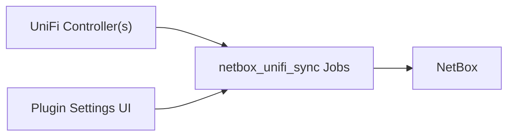

# netbox_unifi_sync

Production-focused UniFi -> NetBox synchronization as an in-platform NetBox plugin.

## Documentation

- [Upgrade to v0.3.27](./upgrade.html)
- [Server Install Guide](./server-install.html)
- [NetBox Plugin Mode](./netbox-plugin.html)
- [Configuration](./configuration.html)
- [Architecture](./architecture.html)
- [Troubleshooting](./troubleshooting.html)
- [FAQ](./faq.html)
- [Cleanup](./cleanup.html)
- [Device Specs](./device-specs.html)
- [Release & PyPI Publish](./release.html)
- [QA Checklist](./qa-checklist.html)
- [Bug Report](./bug-report.html)

## Visuals

## Notes

- Primary sync direction is UniFi -> NetBox.
- DHCP-to-static conversion writes to UniFi only when `dhcp_writeback_enabled` is explicitly enabled.
- Local UniFi Integration API keys are supported; `unifi.ui.com` cloud keys are not drop-in compatible.

## Current release

[v0.3.27](https://github.com/unifi2netbox/netbox-unifi-sync/releases/tag/v0.3.27)
is published on [PyPI](https://pypi.org/project/netbox-unifi-sync/0.3.27/).
Start with the upgrade guide for changed prefix, identity, device-type and
cleanup behavior. The [release review](reviews/2026-10-31-release-review.md)
records verification and staging limitations.
